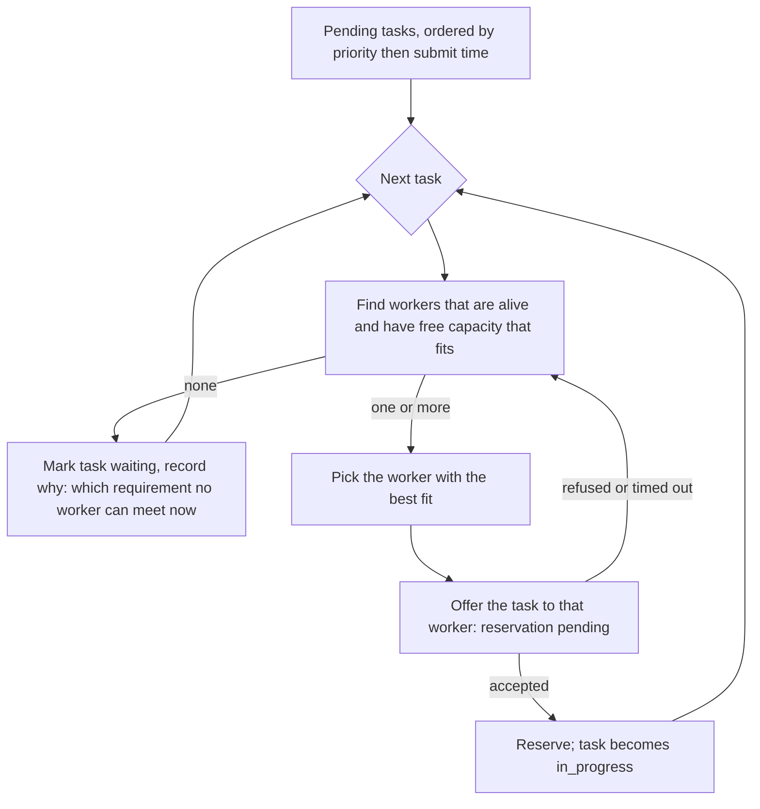
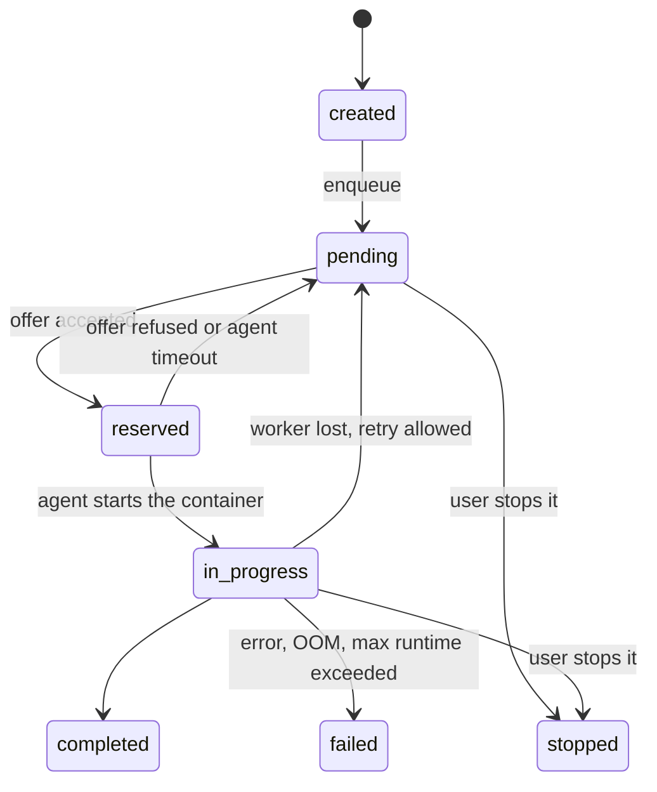

# Concept: resource-aware scheduling without queues

Written for: the owner of the platform, who decides the design, and the people who will build it.

## 1. What we want

- A task states what it needs: CPU cores, RAM, GPUs (count and minimum GPU memory), optionally a GPU model, and a **priority**.
- Workers (agents) state what they have. A worker never runs a task it cannot fit.
- The scheduler gives the next task to a worker that fits, in priority order, and reserves the resources for it.
- Each running task gets **hard limits** from its reservation. A task that uses more RAM than it reserved is killed, and the task is marked failed with the reason. It does not borrow from its neighbours.
- Queues are removed. A task is not put into a named queue; it competes for resources.

The mechanism is the same for one large machine with several jobs side by side and for a fleet of machines.

## 2. Where we are today

| Part | Today | Consequence |
|---|---|---|
| Server | A task is put in a named queue (`tasks.enqueue` with `queue`). `queues.get_next_task` pops the first entry of that queue (`bll/queue/queue_bll.py`). | Placement is by queue name only. Priority is the position in the list, which can be changed by hand. |
| Agent | One daemon per worker. It is started with the queues it serves and the GPUs it may use (`--queue`, `--gpus`). It asks the server for the next task of each of its queues (`get_next_task`) and runs one task at a time per worker. | To run several jobs on one machine, you start several daemons and split the GPUs by hand. |
| Dynamic GPUs | `--dynamic-gpus` splits GPUs between queues by count. | Only GPUs, only by count. No RAM, no CPU, no memory per GPU. |
| Capacity | A worker registers its name and queues. It sends usage (CPU, RAM, GPU utilisation) in `status_report`. | The server does not know what a worker owns. Usage is reported, not reserved. |
| Limits | No Docker `--memory` or `--cpus` is passed (checked in `clearml_agent/commands/worker.py`). | A job can take all the RAM of its machine. |

The gap is in four places: a task has no requirements, a worker has no declared capacity, nothing reserves capacity, and nothing enforces it.

## 3. The model

### 3.1 Requirements and priority on a task

```json
{
  "requirements": {
    "cpus": 4,
    "ram_gb": 12,
    "gpus": {"count": 1, "min_memory_gb": 24, "model": null},
    "disk_gb": 50,
    "max_runtime_min": 720
  },
  "priority": 100
}
```

- `cpus`, `ram_gb`, `gpus.count`: hard minimums. A worker must have them free.
- `gpus.min_memory_gb`, `gpus.model`: a GPU must match both (model optional).
- `max_runtime_min`: the job is stopped after this time (protects the machine from runaway jobs).
- `priority`: integer, higher runs first. Ties go to the earlier submission.
- A task with no requirements gets defaults (1 CPU, 1 GB RAM, no GPU), set by the server configuration.

### 3.2 Capacity on a worker

Sent once at registration, and again when the hardware changes:

```json
{
  "worker": "gpu-box-01:daemon-a",
  "capacity": {
    "cpus": 32,
    "ram_gb": 32,
    "disk_gb": 800,
    "gpus": [
      {"index": 0, "model": "NVIDIA L40S", "memory_gb": 48},
      {"index": 1, "model": "NVIDIA L40S", "memory_gb": 48}
    ]
  },
  "limits": {"max_concurrent_tasks": 4}
}
```

A machine is one worker. Its `capacity` is the whole machine. Sub-workers are not needed any more.

### 3.3 Allocation: the server's ledger

For every worker, the server keeps the sum of what its running tasks reserved. `free = capacity - allocated`. This is the value the scheduler uses. It is authoritative: the usage a worker reports is for information only, and a task's reservation is never changed by usage.

A reservation is `{task, worker, cpus: [...ids], ram_gb, gpus: [indices], since}`. CPU ids and GPU indices are chosen by the worker at claim time from what is free on it, so that the worker can pin them.

## 4. The scheduler

### 4.1 Where it runs

**Decision: the server places tasks; the worker enforces.**

- The server sees all workers and all tasks. Priority is global, not per machine. Auditing and the existing auth checks stay in one place.
- The worker keeps its own resource ledger and enforces the limits. It accepts a claim only if the reservation fits, so a stale server view cannot over-commit a machine.

(The alternative, each worker pulling the best task it can fit, is simpler but cannot honour a global priority order and needs every worker to see the whole queue. It is listed in section 9.)

### 4.2 The loop



- **Best fit:** the worker that leaves the least unused capacity; ties go to the least recently used worker.
- **Aging:** a waiting task's effective priority grows with its waiting time, so a large job is not starved by small ones.
- **Backfill (later):** if the top task cannot fit anywhere, a smaller task may run in the gap, provided it finishes before the top task could start. This needs `max_runtime_min` to be honest.

### 4.3 Events

```mermaid
sequenceDiagram
    participant SDK as SDK / UI
    participant S as Server (scheduler)
    participant A as Agent (daemon)
    participant D as Docker
    SDK->>S: tasks.enqueue(task, requirements, priority)
    S->>S: task pending, ordered by priority
    A->>S: workers.register(capacity)
    loop every few seconds
        S->>S: match pending task to a worker with free capacity
        S->>A: offer(task, requirements)
        A->>A: check local ledger; choose CPUs and GPUs
        A->>S: claim(task, cpus, gpus) 
        S->>S: reserve; task in_progress
    end
    A->>D: run container --memory ram --cpus n --gpus device=i
    loop every 30 s
        A->>S: status_report(usage per task, heartbeat)
    end
    alt task exits normally
        A->>S: release(task, status completed)
    else task exceeds RAM
        D-->>A: killed (OOM)
        A->>S: release(task, status failed, reason oom)
    else worker goes silent
        S->>S: heartbeat expired: release reservations
        S->>S: task requeued (retry policy) or failed
    end
```

### 4.4 Task states



`queued` is replaced by `pending` (with `reserved` in between). Existing states stay.

## 5. The agent: resource management

### 5.1 One daemon per machine

The daemon detects the machine (CPU cores and their ids, RAM, GPUs and their memory, disk) and registers it. It then runs several tasks at once, up to what is free. The many-daemons setup goes away.

### 5.2 The local ledger

The agent keeps the authoritative local picture of what is in use:

- `cpus`: a set of core ids. A task gets `n` cores; they are passed to Docker as `--cpuset-cpus`.
- `ram`: bytes. A task gets `ram_gb`; it is passed as `--memory` with `--memory-swap` equal to it (no swap, so the limit is hard).
- `gpus`: indices. A task gets some; they are passed as `--gpus device=…`, and the container sees only those.
- `disk`: a per-task working directory with a quota where the filesystem supports it, otherwise a check at start.

The ledger is written to disk. On restart, the agent reads it and reconciles it with the containers it finds (Docker labels each container with its task id and reservation).

### 5.3 Claim and run

1. The server offers a task. The agent checks the ledger. If the task fits, it chooses cores and GPUs, reserves them locally, and returns the claim.
2. The agent fetches the job token for the task (as today) and starts the container with the limits.
3. While the task runs, the agent reports usage per task in `status_report` (as today, now per task).
4. On exit, it removes the reservation and reports the outcome.

### 5.4 Enforcement

- **Docker (required for hard limits):** `--memory`, `--memory-swap`, `--cpuset-cpus`, `--gpus device=…`, `--pids-limit`, and a timeout that stops the container at `max_runtime_min`.
- **OOM:** the kernel kills the container. The agent reads the exit reason and reports `failed` with `reason: oom` and the reserved and observed memory. This is the behaviour you asked for.
- **Virtualenv jobs:** no kernel-enforced limits without cgroups. For the first version, a task that asks for hard limits must run in Docker; the agent refuses a claim for such a task if Docker is not available. Virtualenv stays available for tasks that accept soft limits.
- **Disk:** checked at start and reported; hard enforcement needs a quota filesystem.

### 5.5 Failure handling

- **Container crash:** reservation released, task failed with the exit reason.
- **Agent crash:** the server stops receiving heartbeats; after the timeout it releases the worker's reservations and requeues or fails the tasks. On restart, the agent reconciles running containers: a container still running for a task the server has released is stopped.
- **Network loss:** the agent keeps running its tasks. It does not accept new claims until the server answers again.

## 6. SDK

- `Task.init(...)` stays. A task gets its requirements from the code or the UI:

  ```python
  task = Task.init(project_name="demo", task_name="train")
  task.set_requirements(cpus=4, ram_gb=12, gpus=1, gpu_min_memory_gb=24, priority=100)
  Task.enqueue(task)  # no queue name
  ```

- `Task.enqueue(task, queue_name=...)` keeps working for one release, and maps to a requirements profile with a warning.
- Pipelines: a step declares its requirements instead of its queue. Steps run in the order their dependencies allow, and the scheduler places them.
- Local runs are unchanged.
- The SDK checks that at least one registered worker could ever fit the requirements, and warns with the largest available values if none can.

## 7. Server changes

| Area | Change |
|---|---|
| Worker model | `resources` gets `cpus`, `ram_gb`, `gpus` (index, model, memory), `disk_gb`; registration and status reports carry them. |
| Task model | `requirements`, `priority`, `reservation` (worker, cpus, ram, gpus, since), `wait_reason`, `last_heartbeat`. |
| Scheduler | A new background loop (`bll/scheduler`): priority order, best fit, offer, claim, release, aging. Runs every few seconds per company. |
| API | `tasks.enqueue` without a queue; `scheduler.claim` (agent accepts an offer); `scheduler.release` (agent reports the end). `queues.*` stay read-only for migration, then go. |
| Heartbeats | A worker is alive while `status_report` arrives within a timeout (default 60 s). |
| Audit | Reservation, release and requeue events (already the audit log's job). |
| Job tokens | Unchanged: tied to the task and to the device that holds the reservation (`last_device`). |

## 8. Web app

- The **Queues** tab is removed, with the queue pages and the queue selector in the enqueue dialog.
- A **Scheduling** view replaces it: pending tasks ordered by priority, each with its requirements and its `wait_reason` (for example "no worker has 12 GB free").
- The **Workers** view shows each machine's capacity, its reservations, and live usage per task.
- The dashboard built earlier takes its totals and bars from real capacity and reservations, not from sample data.

## 9. Options not chosen

- **Worker pulls (no server placement):** simpler, but no global priority, and every worker must see the whole pending list. Rejected for the first version.
- **Keep queues as priorities:** a queue can carry a priority, but it still forces the user to pick a queue and still cannot express "12 GB". Rejected.
- **Kubernetes scheduling:** would replace the agent with pods. Possible, but it is a platform change, not a feature of this design.

## 10. Phases

| Phase | Content | Outcome |
|---|---|---|
| 0 | This design, decisions in section 11 | Agreed model |
| 1 | Capacity in registration and status reports; one-daemon-per-machine detection (agent and server) | Server knows what each machine has |
| 2 | Task requirements and priority (SDK, server model, API); queues still work | Tasks carry requirements |
| 3 | Server scheduler: pending list, best fit, offer, claim, release, aging, heartbeats | Placement by requirements, reservations kept |
| 4 | Agent ledger, multi-task runs, Docker limits, OOM reporting, crash reconciliation | Hard limits enforced |
| 5 | Web: Scheduling view, Workers capacity view, dashboard on real data; queues removed | UI matches the model |
| 6 | Pipelines use requirements; migration of existing queues to profiles; queues removed | Queues gone |
| 7 | Tests: unit (ledger, matching, aging), integration (claim races, agent crash, OOM), load (many tasks, many workers) | Verified |

Estimate for one experienced developer working on the agent, server and SDK: about 10 to 14 weeks, plus the review of phases 3 and 4. Phase 4 is the largest risk and should be built first on one machine.

## 11. Decisions needed

1. **Placement on the server (section 4.1)** or worker pulls. Recommended: the server.
2. **Hard limits only through Docker** for tasks that declare RAM. Virtualenv jobs keep soft limits. Recommended: yes.
3. **Priority model:** static integer with aging (recommended), or priority classes (for example `low`, `normal`, `urgent`).
4. **Preemption** (stopping a running low-priority task for a high-priority one): not in version 1. Do you want it later?
5. **Per-user or per-project quotas**: not in version 1. Needed before many people share the machines?
6. **Default requirements** when a task declares none: proposed 1 CPU, 1 GB RAM, no GPU.
7. **Retry policy** when a worker is lost: proposed retry once, then fail.

## 12. Risks

- **Stale capacity:** the server's view can lag a machine that changed. Mitigation: the worker refuses a claim it cannot fit; the server retries the next worker.
- **Docker dependency:** hard limits need Docker on every machine that runs such tasks. Mitigation: the agent reports which limits it can enforce, and the scheduler only places tasks on workers that can.
- **Starvation** of large tasks: mitigation through aging, and optional backfill.
- **Load on the scheduler:** many tasks and workers. Mitigation: the scheduler works per company and per changed worker, not on every pending task at every tick.
- **Migration:** existing pipelines and scripts use queues. Mitigation: queues keep working for one release, mapped to requirement profiles.
